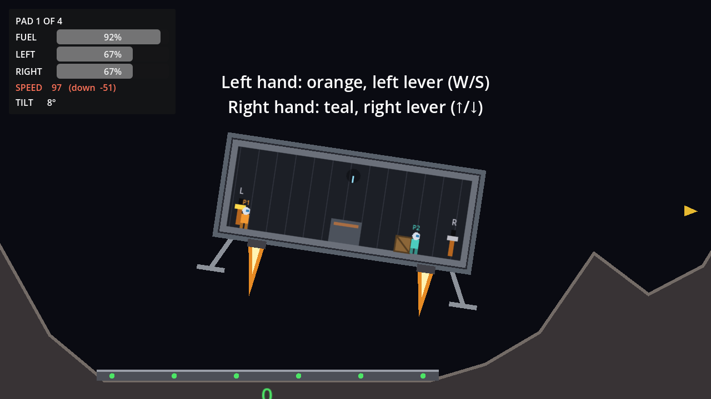

# Godot learning

Small, finished Godot games for learning the engine, one genre at a time. Each game comes with a **spec** (what it is and how it's built) and a **guide** (what to do and learn, step by step, with checkboxes that remember your progress in this browser).

Code: [github.com/TheCosmicKitchen/Godot-Learning](https://github.com/TheCosmicKitchen/Godot-Learning)

## Start here

| | |
| --- | --- |
| [Roadmap](roadmap.md) | The ten games, and how the work is split between you and Claude |
| [Syllabus](syllabus.md) | Ten units of Godot: goals, reading, exercises |

## Lessons

| # | Game | Spec | Guide | Status |
| --- | --- | --- | --- | --- |
| 1 | **Touchdown**: land a ship by steering both crew at once | [Spec](touchdown/spec.md) | [Guide](touchdown/guide.md) | Set up, your turn |
| 2 | Pressure: grid puzzle | | | Planned |
| 3 | Hold the Line: arena survival | | | Planned |
| 4 | Crumble: local party game | | | Planned |
| 5 | Deep Hand: card game | | | Planned |
| 6 | Two Keys: online co-op puzzle | | | Planned |
| 7 | Dig Beat: rhythm game | | | Planned |
| 8 | Little Camp: colony sim | | | Planned |
| 9 | Diorama Drive: a 3D detour | | | Planned |
| 10 | Sand Jar: falling-sand toy | | | Planned |

## How each game works

1. **Setup (Claude):** the project, scenes, input, placeholder art and game loop, with the core methods left empty and marked `// YOU:`.
2. **Core (you):** follow the guide and write those methods by hand. Ask Claude for hints and explanations, not answers.
3. **Review (Claude, with you):** a code review and an idiomatic Godot review of what you wrote. You make the fixes.
4. **Polish (together):** feel, sound and the extras that make it fun. Then a short note on what you learned.
