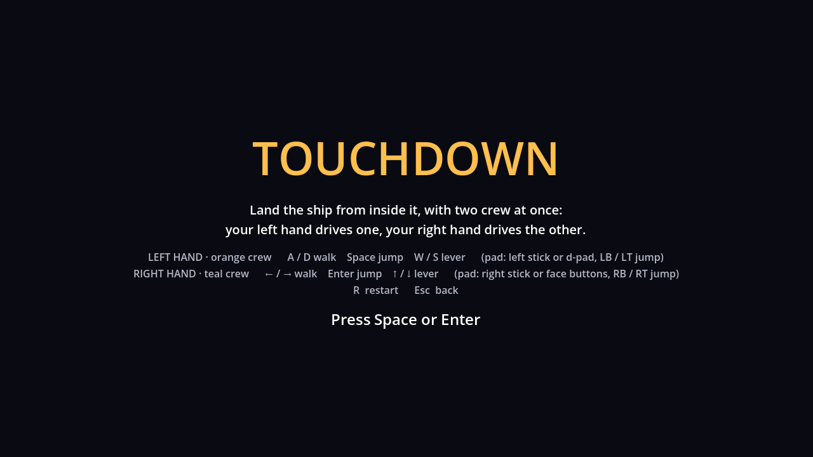
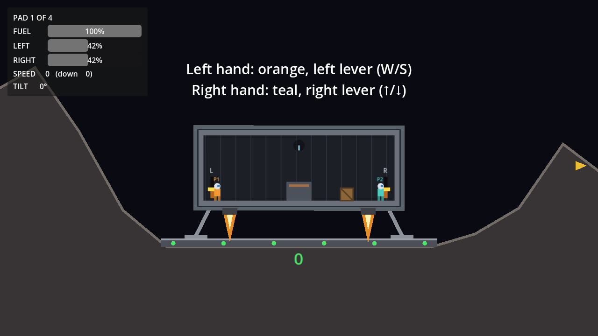
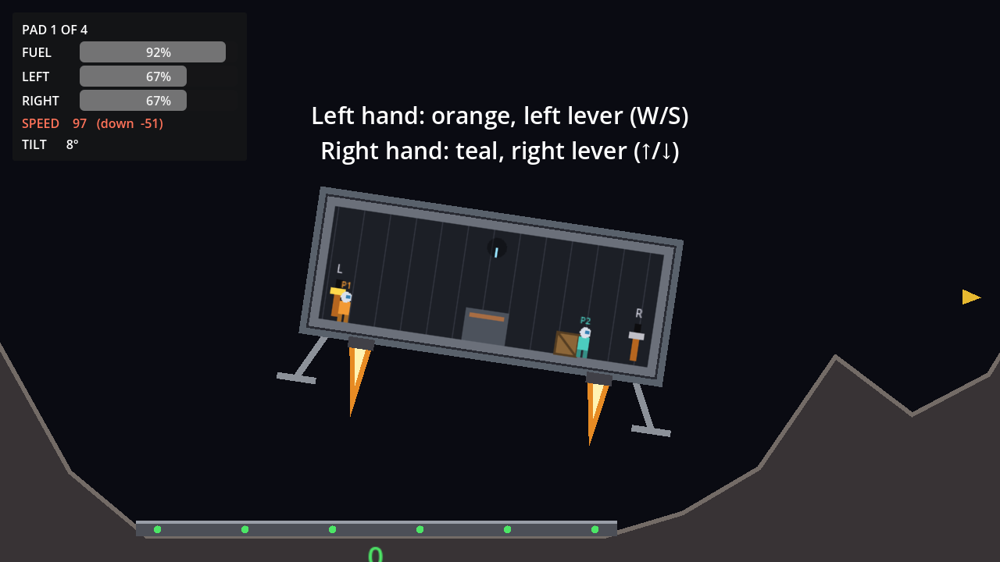
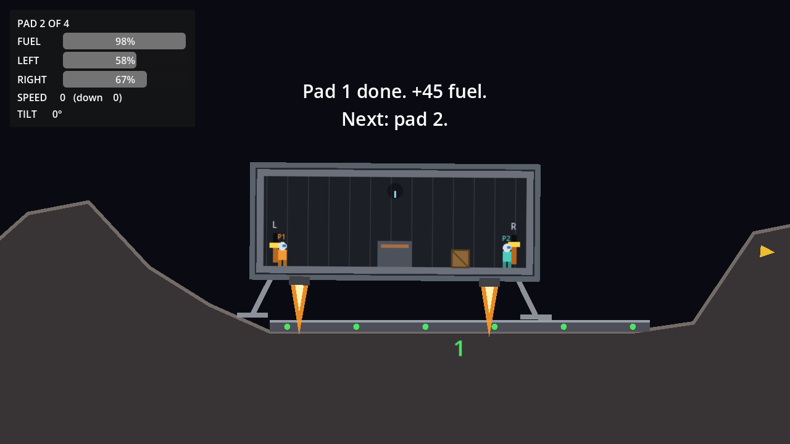
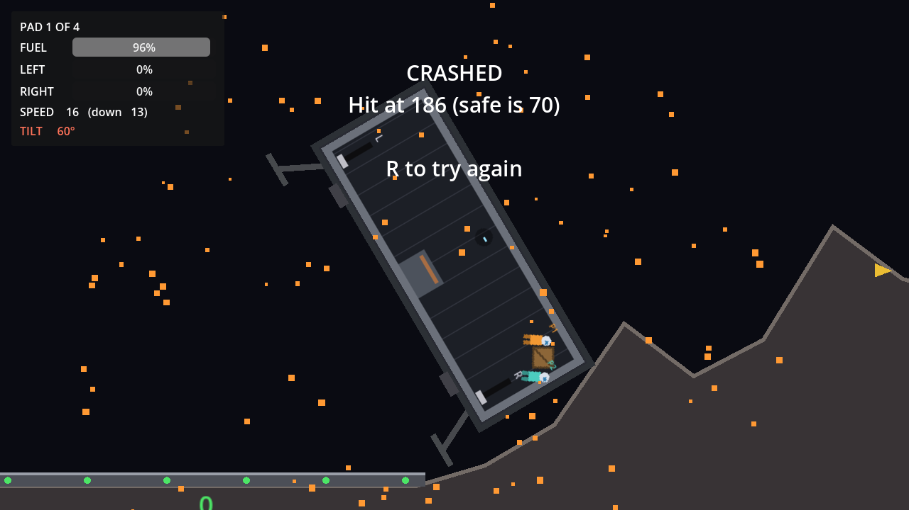

# Touchdown: project spec

Game 1 of the [roadmap](../roadmap.md). Read this to know what the game is and how it's built. The [guide](guide.md) is the step-by-step path through writing it. The code is in [`01-touchdown/`](https://github.com/TheCosmicKitchen/Godot-Learning/tree/main/01-touchdown).

| | |
| --- | --- |
| **Genre** | Arcade lander with a twist |
| **Players** | One, using both hands: one keyboard or one gamepad |
| **Length** | 3–10 minutes a run |
| **Engine** | Godot 4.7 .NET, C#, 2D, Compatibility renderer |
| **Syllabus units** | 1 Editor and scenes · 2 C# and input · 3 Physics · 4 Signals (you write these); 5, 6 and 8 already written, to read |

## The pitch

A lander game where you never touch the ship's controls directly. The ship is shown in cross-section, with two small crew inside, one at each thruster lever. **Your left hand drives the orange crew and your right hand drives the teal one, both at the same time.** Each lever stays where it's left, so flying is a two-handed juggle: trim both throttles, keep the weight balanced, and land softly on the next pad.



## Core loop

1. **Start** parked on pad 0, with both crew at their levers.
2. **Lift off:** push both levers up together.
3. **Fly** to the blinking target pad. The arrow at the screen edge points to it. Trim each lever to steer: more left thrust turns the ship right, and more right thrust turns it left.
4. **Land** on the pad slowly and level. Sitting still on it for a moment counts as a landing and refuels the ship.
5. **Repeat** for pads 1 to 4. Landing on pad 4 wins.
6. **Crash** if you touch anything too fast or too tilted. **Stranded** if the fuel runs out and the ship stops anywhere but a pad, or falls off the world. R restarts.



## What makes it interesting

- **Weight matters.** Each crew member and the loose crate press down on the ship where they stand. Walking one crew member toward the middle tips the ship, and that's often the only way to rebalance it in time.
- **The cabin feels the flight.** "Down" for the crew is gravity minus the ship's own acceleration, turned into the ship's frame. Tilting the ship tilts the floor. Thrusting hard presses the crew down. Falling freely makes them float, so they can't walk.
- **Crashes are physical.** A hard hit throws the crew and the crate across the cabin.
- **Two hands, one brain.** Easy when both crew stand still. The game gets good when one has to move, swap ends, or help at the other lever while the other hand keeps flying.



## Controls

| Hand | Crew | Keyboard | Gamepad |
| --- | --- | --- | --- |
| Left | Orange, starts at the left lever | A / D walk, Space jump, W / S lever up / down | Left stick or d-pad; LB or LT jump |
| Right | Teal, starts at the right lever | ← / → walk, Enter jump, ↑ / ↓ lever up / down | Right stick or face buttons (X / B walk, Y / A lever); RB or RT jump |
| Either | | R restart, Esc back to title | Start restart, Back to title |

A lever only responds to whoever is standing at it, using that crew member's own keys. Teal can walk over and work the left lever with the arrow keys.

## Rules and numbers

All of these are `[Export]` fields, so you can tune them in the Inspector without touching code.

| What | Value | Where |
| --- | --- | --- |
| World gravity | 200 px/s² | Project Settings → Physics → 2D |
| Ship mass | 10 | `Ship.tscn` |
| Crew mass, each | 1.5 | `Crew.cs` `Mass` |
| Crate mass | 1.5 | `Interior.tscn` |
| Thrust per thruster at full throttle | 2300 | `Ship.cs` `MaxThrust` |
| Throttle to hover, fully loaded | about 63% on each lever | follows from the above |
| Fuel | 100, burning 1.4 per second per thruster at full throttle | `Ship.cs` |
| Fuel back per pad landed | +45, capped at 100 | `Main.cs` `RefuelPerPad` |
| Safe touchdown speed | 70 px/s or less | `Ship.cs` `SafeSpeed` |
| Safe touchdown tilt | 14° or less | `Ship.cs` `SafeTiltDegrees` |
| Time still on a pad to count | 0.8 s | `Main.cs` `SettleTime` |
| Cabin gravity | 4.5 × the felt gravity, capped at 5 g | `Ship.cs` |
| Crew walk / jump | 140 px/s, 330 px/s jump | `Crew.cs` |
| Lever speed | 0.6 full throws per second | `Lever.cs` `Rate` |
| Pads | 5 (0 to 4), 2600 px apart, ridges growing taller each leg | `Terrain.cs` |





## Screens

| Screen | Scene | Shows |
| --- | --- | --- |
| Title | `title/Title.tscn` | Name, pitch, both control schemes. Space or Enter starts. |
| Game | `main/Main.tscn` | World, ship and cabin. HUD: pad, fuel, both throttles, speed, tilt (red when unsafe), target arrow, messages. |
| End messages | inside Game | TOUCHDOWN (won, with time and fuel), CRASHED (why), STRANDED. R restarts. |

## How it's built

```
Title.tscn ──(Space/Enter)──▶ Main.tscn
                              ├── Terrain (Node2D)          builds the ground, instances Pad.tscn ×5
                              ├── Ship (RigidBody2D)        hull, feet, thruster markers
                              │   ├── InteriorViewport (SubViewport, its own physics world)
                              │   │   └── Interior          walls, LeftLever, RightLever, Crew1, Crew2, Crate
                              │   └── InteriorView (Sprite2D)  shows the viewport's picture on the hull
                              ├── Camera (Camera2D)         follows, leads and zooms with altitude
                              └── Hud (CanvasLayer)
```

**The cabin trick.** The cabin is not in the same physics world as the ship. It sits in a `SubViewport`, which has its own physics world, so it's a small room that never moves. A sprite on the ship shows the room's picture, so it turns with the ship. Every physics frame:

1. The ship computes the felt gravity and sets `Interior.Gravity`. Loose objects follow it automatically; the crew reads it in their own code.
2. The ship asks `Interior.Loads()` where everything with weight is, and calls `ApplyForce` at those points on its own body.

**Two crew, one script.** `Crew1` and `Crew2` are instances of `Crew.tscn` with a different exported `Player` (1 or 2). `Crew.Action("jump")` turns that into the `p1_jump` or `p2_jump` input action.

**Signals.**

| Signal | From | Listened to by | Means |
| --- | --- | --- | --- |
| `BodyEntered` / `BodyExited` | each `Lever` (Area2D) | the lever itself | a crew member walked into or out of reach |
| `ThrottleChanged` | `Lever` | nobody yet (the HUD polls) | the lever moved |
| `BodyEntered` | `Ship` (RigidBody2D, contact monitor on) | the ship itself | the hull or feet touched something |
| `TouchedDown(body)` | `Ship` | `Main` | a gentle touch; Main checks whether it's the target pad |
| `Crashed(speed, tilt)` | `Ship` | `Main` | too hard: game over |

## Who builds what

| Part | Who | State |
| --- | --- | --- |
| Project, input map, scenes, terrain, cabin physics, HUD, camera, title, game flow, test tools | Claude (setup) | Done |
| **1.** Crew walking and jumping when "down" changes (`Crew._PhysicsProcess`) | You | To do |
| **2.** Levers: who's in reach, and moving the throttle (`Lever.cs`) | You | To do |
| **3.** Thrusters: force at each offset, and fuel burn (`Ship.FireThrusters`) | You | To do |
| **4.** Landing or crash, and emitting the signal (`Ship.OnBodyEntered`) | You | To do |
| Code review and idiomatic Godot review | Claude, with you | After 1–4 |
| Polish: sound, particles, best score and the ideas below | Together | After review |

The screenshots on this page were taken with throwaway versions of parts 1–4. Those were removed again, so the repo has empty stubs for you to fill.

## Done when

- [ ] Both crew walk and jump at the same time, each on its own keys, on a tilted floor too.
- [ ] Each lever moves only for whoever stands at it, with their keys.
- [ ] The ship lifts with both levers up, and turns when they differ.
- [ ] A soft, level touchdown on the target pad counts; a hard or tilted one crashes.
- [ ] A full run can be won (land on pad 4).
- [ ] Code review done and fixes made.

## Not in this game

Sound, saving a best score, wind, cargo pickups, injuries, two-person mode on two gamepads. All of those are polish candidates, listed in the game's README.

## Ideas for STRATA

Touchdown is a small version of STRATA's walkable vehicle interior: stations far apart, a crew that has to be at a station for it to work, and trouble that comes from how you drive. Note anything that feels good or bad here in the game's README under "Notes after playing".
